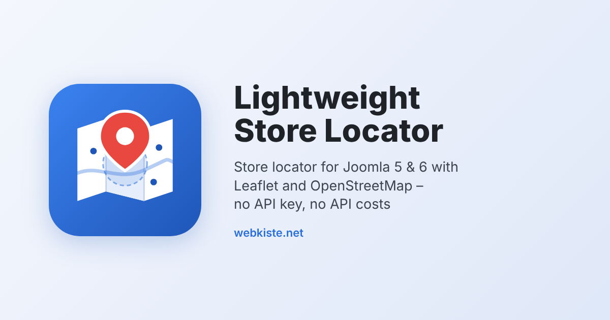

# Lightweight Store Locator (Leaflet & OSM) for Joomla

A fast store locator for Joomla 5 and 6 – based on [Leaflet](https://leafletjs.com) and [OpenStreetMap](https://www.openstreetmap.org). No Google Maps API key, no API costs, no libraries from CDNs.

*Deutsche Kurzanleitung weiter unten.*

## What's included

The package installs three extensions:

| Extension | Purpose |
|---|---|
| **Component** “Store Locator” | Manage locations in the backend: create and edit, import from CSV/XLSX, export, geocoding at the click of a button |
| **Module** “Lightweight Store Locator” | Map and list on your website, or a compact quick search for the home page or a sidebar |
| **Task plugin** | Scheduled tasks: import a file from the server (e.g. a nightly CRM export) and geocode new locations automatically |

## Features

**Website**
- Search by postcode or town, or by the visitor's current position
- Radius filter (10–200 km), results sorted by distance, optional country filter
- List and map side by side; click a result to show it on the map
- Directions with Google Maps, Apple Maps or OpenStreetMap
- Compact quick-search mode that opens the page with the full map
- **Privacy:** map tiles and town search are only loaded after the visitor's consent (can be remembered on the device); Leaflet itself is bundled with the module
- Email addresses of your locations are never output to the page
- Colours, map height, tile server and attribution can be configured

**Backend**
- List with search, filters (status, country, coordinates) and sorting
- **Import** CSV or Excel (XLSX): separator and encoding are detected automatically, column headings are recognised in several languages and from CRM exports (e.g. “Account-ID”, “Straße (Postanschrift)”, “PLZ”, “City”, “Zip”)
- **Preview before import:** see every new, changed and removed location before anything is written
- Locations are matched by an external ID (e.g. CRM account ID) – or by name, postcode and street
- Locations missing in the file can be kept, unpublished or deleted – with a **safety limit** against incomplete exports
- Postcodes are normalised (e.g. German postcodes that lost their leading zero in Excel)
- **Geocoding** with OpenStreetMap Nominatim in several stages – exact (street, postcode, town) down to approximate (postcode or town) – respecting Nominatim's usage policy (one request per second, identifying user agent, optional contact email)
- Status per location: exact, approximate, not found, set manually
- Coordinates are only looked up again when the address really changes
- CSV export of all locations

## Requirements

- Joomla 5.x or 6.x
- PHP 8.1 or newer, MySQL or MariaDB
- For XLSX import: PHP extension `zip` (CSV works without it)

## Getting started

1. Install `pkg_lwstorelocator-x.y.z.zip` under *System → Install → Extensions*.
2. Open *Components → Store Locator*, click **Import**, download the **sample file** and import it – or import your own CSV/XLSX file.
3. Click **Geocode now** to look up the coordinates of locations without coordinates. Keep the page open; Nominatim allows one request per second.
4. Create a site module of the type **Lightweight Store Locator** and assign it to a page.
5. Optional: a second module in **Compact** mode for the home page, linked to the page with the map.

### Import file

Only a name and at least a postcode or town are required. Recognised columns:

| Column | Content |
|---|---|
| `external_id` | ID from your source system – recognises the location on the next import (recommended) |
| `name` | Name of the store or dealer (required) |
| `address` | Street and house number |
| `postal` | Postcode |
| `town` | Town |
| `country` | ISO code (DE, AT, CH …) or country name (“Germany”, “Deutschland”, “Österreich” …) |
| `phone`, `email`, `website` | Contact data (email is not shown on the website) |
| `latitude`, `longitude` | Optional – otherwise geocoded |
| `published` | Optional: 1/0, yes/no |

### Automatic import and geocoding

Under *System → Scheduled Tasks → New* you find two task types:

- **Store Locator – Import file:** imports a file from the server, e.g. a nightly export of your CRM. The path can be relative to the Joomla folder or absolute (outside the web root is recommended).
- **Store Locator – Geocode locations:** geocodes new and changed locations in batches.

For reliable runs use the Joomla CLI scheduler (`php cli/joomla.php scheduler:run`) via a server cron job instead of the lazy scheduler.

### Fair use

- **Nominatim:** please enter a contact email in the component options and respect the [usage policy](https://operations.osmfoundation.org/policies/nominatim/). The town search on the website also uses Nominatim.
- **Shared hosting:** many sites share one IP there, so Nominatim may throttle the server (HTTP 429). Geocoding in the backend then continues automatically in your browser; the scheduled task tries again on its next run.
- **Map tiles:** the OpenStreetMap tile server is fine for moderate traffic. For high traffic use your own or a commercial tile provider (module setting “Tile server”), see the [tile usage policy](https://operations.osmfoundation.org/policies/tiles/).

## Deutsche Kurzanleitung

1. Paket unter *System → Installieren → Erweiterungen* installieren.
2. *Komponenten → Händlersuche → Importieren*: Beispieldatei herunterladen und importieren – oder die eigene CSV/XLSX-Datei. Vor dem Import zeigt eine Vorschau alle Änderungen.
3. **Jetzt geocodieren** klicken, damit die Koordinaten ermittelt werden (Seite geöffnet lassen).
4. Ein Site-Modul vom Typ **Lightweight Store Locator** anlegen und einer Seite zuweisen.
5. Für regelmäßige Importe aus dem CRM: *System → Geplante Aufgaben* → „Händlersuche – Datei importieren“ und „Händlersuche – Standorte geocodieren“.

## Support

Questions and bug reports: [GitHub Issues](https://github.com/KiSte1204/mod_storelocator/issues)

## License

- Lightweight Store Locator: © 2026 Stefan Kirchhoff, [webkiste.net](https://www.webkiste.net/) – GNU General Public License version 2 or later, see [LICENSE.txt](LICENSE.txt)
- Bundled [Leaflet](https://leafletjs.com) 1.9.4: © Volodymyr Agafonkin, CloudMade – BSD 2-Clause License, see `mod/media/leaflet/LICENSE`
- Map data © OpenStreetMap contributors (ODbL)
